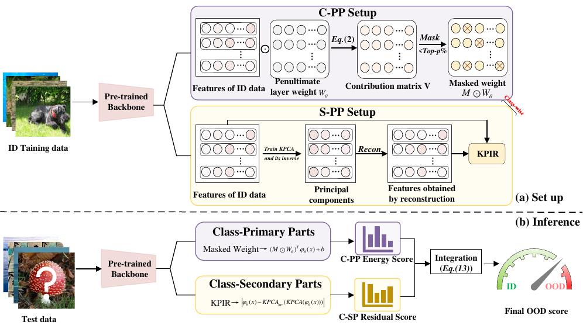

# DFSD Reproduction

This repository provides a clean reproduction package for **Out-of-Distribution Detection with Directed Feature Space Decomposition (DFSD)**. It contains the DFSD scoring code, fixed experiment configs, component ablations, metric computation, and visualization utilities.

The repository intentionally does **not** include large datasets, checkpoints, extracted features, score files, or caches. Put those files under the documented relative paths after downloading them.

## Attribution

This reproduction package uses the same post-hoc OOD evaluation setting as the DICE codebase. The CIFAR data/checkpoint organization, DenseNet checkpoint usage, RouteDICE/DICE model wrapper, and the DICE-based C-PP component are adapted from the official DICE repository:

- DICE GitHub: <https://github.com/deeplearning-wisc/dice>
- DICE paper: *DICE: Leveraging Sparsification for Out-of-Distribution Detection*, ECCV 2022.

Please cite DICE when using the DICE checkpoints or DICE-derived C-PP implementation:

```bibtex
@inproceedings{sun2022dice,
  title={DICE: Leveraging Sparsification for Out-of-Distribution Detection},
  author={Sun, Yiyou and Guo, Chuan and Li, Yixuan},
  booktitle={European Conference on Computer Vision},
  year={2022}
}
```

## Method Summary

DFSD decomposes the feature representation of a fixed classifier into two parts:

```text
DFSD score = C-PP score + C-SP score
C-PP       = logsumexp(logits after contribution-based processing)
C-SP       = max_c -alpha_c * ||(z - u) - inverse_c(transform_c(z - u))||
```

The paper setting is `dfsd_main`: C-PP uses the DICE/RouteDICE logits, and C-SP uses class-wise KPCA residuals. The PCA variant `dfsd_main_pca` changes only the C-SP estimator from KPCA to PCA.



## Reproducibility Protocol

Reproduction follows three stages: prepare the environment, datasets, and checkpoints; run a dataset configuration to fit the detector on ID training features and score the evaluation samples; then inspect the per-dataset metrics and their average. The sections below provide the configuration definitions, commands, and output paths for these stages.

### Hyperparameters

| Dataset | Backbone | C-PP `p` | C-SP estimator | KPCA kernel | Dimension parameter | Class fitting | Score classes | Scaling factor |
|---|---:|---:|---|---|---:|---|---|---|
| CIFAR-10 | DenseNet | 60 | class-wise KPCA | Gaussian/RBF | `dim=150` | all ID train classes | all classes | class-wise `alpha_c` |
| CIFAR-100 | DenseNet | 90 | class-wise KPCA | Gaussian/RBF | `dim=250` | all ID train classes | all classes | class-wise `alpha_c` |
| ImageNet-1K | ResNet-50 | 60 | class-wise KPCA | Gaussian/RBF | `dim=100` | 100 images/class | class fraction `0.1` | class-wise `alpha_c` |

The three configurations are [`cifar10_dfsd.json`](dfsd_repro/configs/cifar10_dfsd.json), [`cifar100_dfsd.json`](dfsd_repro/configs/cifar100_dfsd.json), and [`imagenet_dfsd.json`](dfsd_repro/configs/imagenet_dfsd.json). Feature dimension `D` is 342 for the CIFAR DenseNet and 2,048 for the ImageNet ResNet-50.

`dim` is a dimension-control parameter, not the retained dimension. For a class with `n_c` fitting samples, the implementation uses `min(D - dim, max(1, n_c - 1), D)` components. An explicit `pca_components` value further caps the PCA variants only. For ImageNet, `score_class_fraction=0.1` selects a seeded subset of 100 class models for fitting and scoring; it is not an explained-variance threshold. Training feature extraction uses 100 images per class. CIFAR uses all training samples and all class models.

| Configuration key | Meaning / supplied setting |
|---|---|
| `p` | Contribution-masking percentile: 60 / 90 / 60 for CIFAR-10 / CIFAR-100 / ImageNet |
| `seed` | NumPy and PyTorch random seed; supplied configs use 1 |
| `batch_size` | Evaluation batch size; supplied configs use 224 |
| `gpu` | CUDA device selection; default `"0"` |
| `fit_class_fraction` | Fraction used to form the seeded candidate class list; supplied configs use 1.0 |
| `score_class_fraction` | Limits the class models used; 1.0 for CIFAR and 0.1 for ImageNet |
| `imagenet_train_samples_per_class` | ImageNet training sample count per class; default 100 |
| `force_refit` | Regenerate training features and fitted estimators instead of loading cached files; default `false` |
| `base_output_dir`, `subspace_cache_dir` | Output and fitted-model cache roots |

### Fitting and Scoring

The first run extracts ID training features and estimates the contribution information used by C-PP. For C-SP, features are shifted by `u = -pinv(W) @ b`; each selected class has its own KPCA model and inverse mapping. The same shift and fitted mappings are applied at test time. Detector fitting and scaling use ID training data only, and test labels are not needed to score an input.

The main mode uses scikit-learn `KernelPCA` with `kernel="rbf"`, `fit_inverse_transform=True`, `remove_zero_eig=False`, and `copy_X=False`. Other constructor settings, including kernel gamma and inverse-mapping regularization, use the installed scikit-learn defaults. Record the resolved library versions as described under Environment. The executable definitions are in [`fit_or_load_subspaces` and `score_numpy`](dfsd_repro/dfsd.py).


The residual mean is class-specific; the numerator is shared and uses all extracted ID training features:

```text
alpha_c = mean(max training logit) / mean(C-SP training residual for class c)
```

It aligns the C-SP residual scale with the C-PP logit/Energy scale. No OOD samples are used to fit KPCA/PCA, compute `alpha_c`, or calibrate hyperparameters.

### Evaluation Protocol

ID/OOD splits follow the standard post-hoc OOD protocol used by DICE and related work.

| ID dataset | OOD datasets | Backbone/checkpoint | Evaluation split |
|---|---|---|---|
| CIFAR-10 | SVHN, LSUN, LSUN_resize, iSUN, DTD, Places365 | DenseNet checkpoint from DICE-style setup | CIFAR-10 test vs each OOD test set |
| CIFAR-100 | SVHN, LSUN, LSUN_resize, iSUN, DTD, Places365 | DenseNet checkpoint from DICE-style setup | CIFAR-100 test vs each OOD test set |
| ImageNet-1K | iNaturalist, SUN, Places, DTD | torchvision ResNet-50 | ImageNet validation vs each OOD set |

All DFSD variants use the same backbone, feature extractor, ID/OOD splits, and metric implementation. ID samples are treated as positive examples. The operating threshold for FPR95 is set so that 95% of ID samples are accepted.

### Metrics

The reported metrics are standard OOD detection metrics:

- **FPR95**: false positive rate of OOD samples when the true positive rate on ID samples is 95%. Lower is better.
- **AUROC**: area under the ROC curve for separating ID and OOD scores. Higher is better.

The implementation also writes AUIN, AUOUT, and detection error to `metrics.csv`, but paper tables focus on FPR95 and AUROC.

## Repository Layout

```text
dfsd_repro/
  configs/                 # fixed experiment configs
  models/                  # DenseNet/ResNet/RouteDICE model definitions
  utils/                   # dataset, metric, and scoring helpers
  dfsd.py                  # DFSD scoring and PCA/KPCA C-SP variants
  run.py                   # run one config
  run_suite.py             # run CIFAR-10, CIFAR-100, ImageNet configs
  run_ablation.py          # component ablations
  visualize.py             # visualization utilities
  cache/                   # generated locally, ignored by git
  results/                 # generated locally, ignored by git
  figures/                 # generated locally, ignored by git
```

## Environment

```bash
conda env create -f environment.yml
conda activate dfsd
```

All commands below are run from the repository root and use `python -m ...`. The supplied runner requires a CUDA-capable GPU. The environment file specifies Python 3.9 and CUDA 11.8; package versions resolved by Conda should be saved with each run:

```bash
conda env export --no-builds > environment-resolved.yml
python -c "import torch, sklearn; print('PyTorch:', torch.__version__); print('scikit-learn:', sklearn.__version__); print('CUDA available:', torch.cuda.is_available())"
```

The runner seeds NumPy, PyTorch, and CUDA from `seed`. CUDA/cuDNN benchmarking is enabled, so the seed does not guarantee bitwise-identical results across hardware or library versions.

## Data and Checkpoints

Prepare the following local directories. They are ignored by git.

```text
dfsd_repro/checkpoints/
dfsd_repro/id_datasets/
dfsd_repro/ood_datasets/
dfsd_repro/features/          # generated automatically for CIFAR
dfsd_repro/imagenet_feature/  # generated automatically for ImageNet
```

Required CIFAR checkpoints:

```text
dfsd_repro/checkpoints/CIFAR-10/densenet/checkpoint_100.pth.tar
dfsd_repro/checkpoints/CIFAR-100/densenet/checkpoint_100.pth.tar
```

Dataset and checkpoint preparation follows the official DICE repository:
<https://github.com/deeplearning-wisc/dice>

For CIFAR OOD datasets, use the DICE download links and place the extracted
datasets under `dfsd_repro/ood_datasets/`:

- SVHN: <http://ufldl.stanford.edu/housenumbers/>
- DTD: <https://www.robots.ox.ac.uk/~vgg/data/dtd/>
- Places365: <http://data.csail.mit.edu/places/places365/test_256.tar>
- LSUN-C: <https://www.dropbox.com/s/fhtsw1m3qxlwj6h/LSUN.tar.gz>
- LSUN-R: <https://www.dropbox.com/s/moqh2wh8696c3yl/LSUN_resize.tar.gz>
- iSUN: <https://www.dropbox.com/s/ssz7qxfqae0cca5/iSUN.tar.gz>

For ImageNet-1K experiments, prepare ImageNet from the official source and use
the curated large-scale OOD links used by DICE:

- ImageNet-1K: <https://image-net.org/download.php>
- iNaturalist: <http://pages.cs.wisc.edu/~huangrui/imagenet_ood_dataset/iNaturalist.tar.gz>
- SUN: <http://pages.cs.wisc.edu/~huangrui/imagenet_ood_dataset/SUN.tar.gz>
- Places: <http://pages.cs.wisc.edu/~huangrui/imagenet_ood_dataset/Places.tar.gz>
- Textures: <https://www.robots.ox.ac.uk/~vgg/data/dtd/>

### Expected Data Layout

Dataset loaders expect these paths (directory names are case-sensitive):

```text
dfsd_repro/id_datasets/CIFAR-10/cifar-10-batches-py/
dfsd_repro/id_datasets/CIFAR-100/cifar-100-python/
dfsd_repro/id_datasets/imagenet/train/<class>/
dfsd_repro/id_datasets/imagenet/val/<class>/
dfsd_repro/ood_datasets/svhn/test_32x32.mat
dfsd_repro/ood_datasets/LSUN/<class>/
dfsd_repro/ood_datasets/LSUN_resize/<class>/
dfsd_repro/ood_datasets/iSUN/<class>/
dfsd_repro/ood_datasets/dtd/images/<class>/
dfsd_repro/ood_datasets/places365/<class>/
dfsd_repro/ood_datasets/iNaturalist/<class>/
dfsd_repro/ood_datasets/SUN/<class>/
dfsd_repro/ood_datasets/Places/<class>/
```

ImageFolder-based datasets require image-containing subdirectories. Keep ImageNet validation images organized by class. Training feature extraction and preprocessing are defined in [`dfsd.py`](dfsd_repro/dfsd.py); evaluation loaders are defined in [`ood_utils.py`](dfsd_repro/utils/ood_utils.py).

## Run Main Experiments

```bash
python -m dfsd_repro.run --config dfsd_repro/configs/cifar10_dfsd.json --modes dfsd_main
python -m dfsd_repro.run --config dfsd_repro/configs/cifar100_dfsd.json --modes dfsd_main
python -m dfsd_repro.run --config dfsd_repro/configs/imagenet_dfsd.json --modes dfsd_main
```

Run all configs:

```bash
python -m dfsd_repro.run_suite
```

Summarize existing scores without recomputing inference:

```bash
python -m dfsd_repro.run --config dfsd_repro/configs/cifar10_dfsd.json --modes dfsd_main --metrics-only
```

Scores, metrics, and caches are written under:

```text
dfsd_repro/results/
dfsd_repro/cache/subspaces/
```

### Random Seeds and Cached Fits

The JSON configuration controls `seed` and `force_refit`; these are not command-line flags. The first run creates training-feature files and class-model caches. Later runs reuse these files by default. When changing checkpoints, preprocessing, or fitting settings, set `force_refit` to `true` and use distinct output/cache directories to avoid mixing runs. For example:

```bash
python - <<'PYCONFIG'
import json
from pathlib import Path
src = Path("dfsd_repro/configs/cifar10_dfsd.json")
cfg = json.loads(src.read_text())
cfg.update(seed=1, force_refit=True,
           experiment_name="cifar10_densenet_dfsd_fresh",
           subspace_cache_dir="dfsd_repro/cache/subspaces_fresh")
Path("cifar10_fresh.json").write_text(json.dumps(cfg, indent=2) + "\n")
PYCONFIG
python -m dfsd_repro.run --config cifar10_fresh.json --modes dfsd_main
```

Regeneration also replaces the dataset's training-feature files. Run such configurations sequentially. Once the desired features and fitted models exist, set `force_refit` back to `false` to reuse them.

## Outputs and Run Records

For the supplied CIFAR-10 configuration and main mode, outputs are:

```text
dfsd_repro/results/cifar10_densenet_dfsd/dfsd_main/
  in_scores.txt
  SVHN/out_scores.txt
  LSUN/out_scores.txt
  LSUN_resize/out_scores.txt
  iSUN/out_scores.txt
  dtd/out_scores.txt
  places365/out_scores.txt
  metrics.csv
```

Each score file contains one scalar per evaluated sample; larger scores indicate stronger ID evidence. `metrics.csv` contains one row per OOD dataset and an `AVG` row, which is the unweighted arithmetic mean over OOD datasets. The CSV stores percentages: its `FPR` column denotes FPR95, and `AUROC` is also multiplied by 100. Metric definitions and computation are in [`metrics.py`](dfsd_repro/metrics.py). The `--metrics-only` command above recalculates metrics from existing score files without rerunning inference.

Output paths follow `<base_output_dir>/<experiment_name>/<mode>/`; C-PP alternatives and explicit PCA ranks add mode suffixes. Keep a copy of the JSON configuration, any command-line overrides, and `environment-resolved.yml` alongside the results to identify the settings used for each run.

## Ablations

To run the main score and the two components separately:

```bash
python -m dfsd_repro.run --config dfsd_repro/configs/cifar10_dfsd.json --modes dfsd_main cpp_dice csp_kpca
```

`cpp_dice` scores only the contribution-masked logits, `csp_kpca` scores only the class-wise reconstruction evidence, and `dfsd_main` combines them.

The ablation runner evaluates DICE, ASH, and SCALE as C-PP choices, together with component-only and PCA alternatives:

```bash
python -m dfsd_repro.run_ablation --config dfsd_repro/configs/cifar10_dfsd.json
python -m dfsd_repro.run_ablation --config dfsd_repro/configs/cifar100_dfsd.json
```

C-SP variants:

```bash
python -m dfsd_repro.run --config dfsd_repro/configs/cifar10_dfsd.json --modes csp_kpca csp_pca dfsd_main_pca
python -m dfsd_repro.run --config dfsd_repro/configs/imagenet_dfsd.json --modes dfsd_main_pca --pca-components 3
```

## Visualizations

```bash
python -m dfsd_repro.visualize --config dfsd_repro/configs/cifar10_dfsd.json --figure complementarity --out-dataset SVHN
python -m dfsd_repro.visualize --config dfsd_repro/configs/cifar10_dfsd.json --figure tsne_spaces --out-dataset SVHN
python -m dfsd_repro.visualize --figure evr --dataset CIFAR-10 --seed 1
python -m dfsd_repro.visualize --figure bar_line_ablation --spec dfsd_repro/configs/ablation_eta.json
```
